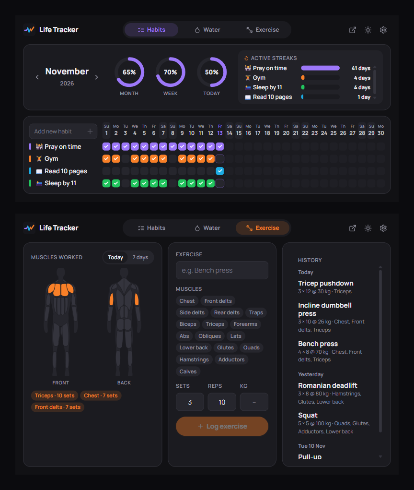

# Life Tracker: Habit, Water and Workout Tracker Chrome Extension

**Life Tracker** is a free, private Chrome extension that tracks your daily habits, water intake and gym workouts in one popup. It has streaks, a hydration goal, and a front/back muscle map that lights up the muscles you trained. No account, no ads, no analytics: your data stays in your browser.

<p align="center">
  
</p>

> Formerly **Hydration Hero**. Version 2 merges the water tracker with a habit tracker and adds workout tracking.

## Contents

- [Project Overview](#project-overview)
- [Features](#features)
- [Install](#install)
- [Privacy](#privacy)
- [Development](#development)
- [Project structure](#project-structure)
- [License](#license)

## Project Overview

Habit apps, water apps and workout apps usually live on your phone, so they get ignored while you work at a computer. Life Tracker puts all three one click away in the Chrome toolbar, each on its own tab so no screen gets cluttered.

It started as two separate extensions: Hydration Hero (a water tracker) and a habit tracker from the Chrome Web Store. Version 2 rebuilds the habit tracker in the same codebase with a wide, landscape popup, gives all three tabs one shared design, and adds an exercise log whose muscle map shows at a glance which muscles you have trained and which you have skipped. Data is saved on your device only, and a backup file lets you move it between browsers.

## Features

### ✅ Habits
- A landscape month grid (habits × days) for checking off daily habits, with emoji names and a colour per habit
- Month, week and today completion rings, plus an active-streaks panel
- Current and best streaks, plus streak badges at 7, 21, 30, 66 and 100 days (with confetti)
- Habit lists are kept per month, so past months keep the habits you had then
- A toolbar badge shows how many habits are left today
- Optional reminders at 8 PM or every hour, only while something is still unchecked

### 💧 Water
- Animated progress tank toward a daily goal (250 ml to 10 L)
- One-tap glass sizes (150 to 750 ml) or any custom amount
- Today's log with undo, and a 7-day history chart against your goal
- The day resets at 3 AM, so late-night glasses count for the evening before
- Optional reminders every 1 or 2 hours between 8 AM and 10 PM

### 💪 Exercise
- Log exercises with sets, reps and weight (kg or lb)
- Front and back male muscle map that highlights the muscles you worked today or over the last 7 days, shaded by sets
- 60+ built-in exercises that fill in their muscle groups automatically; your own exercises are remembered
- Click a muscle to filter your history, and re-log a past exercise in one click

### General
- Dark and light themes, and one design shared by all three tabs
- Open in a full browser tab for a bigger view
- Export all data to a JSON backup file, and import it again (merge or replace)

## Install

Life Tracker is not on the Chrome Web Store yet. Load it from source:

```bash
git clone https://github.com/AbdulDevHub/Life-Tracker.git
cd Life-Tracker
pnpm install
pnpm build
```

1. Open `chrome://extensions` and switch on **Developer mode** (top right).
2. Click **Load unpacked** and pick the `build` folder.
3. Pin Life Tracker to the toolbar.

To update later, pull the latest code, run `pnpm build` again, and click the reload icon on the extension card. Your data is kept.


## Privacy

- Everything is stored in `chrome.storage.local` on your device. Nothing is sent anywhere.
- Permissions: `storage` and `unlimitedStorage` (your data), `alarms` and `notifications` (reminders and the badge). It does not read the pages you visit.

## Development

```bash
pnpm dev      # app in a normal browser tab at localhost:5173 (uses localStorage)
pnpm test     # unit tests (import converter, streak logic)
pnpm lint     # ESLint
pnpm build    # production extension in build/
```

Open `http://localhost:5173/?demo=1&tab=exercise` to load sample data. You can add `&theme=light` or `&view=tab`.

Built with React 18, Vite 5, Tailwind CSS 3, React Icons (Lucide), canvas-confetti and the Manrope font. Chrome Manifest V3.

## Project structure

```
public/
  manifest.json        Manifest V3
  background.js        Service worker: toolbar badge and reminders
  icons/               Logo (logo.svg is the master)
src/
  App.jsx              Header, tab bar, settings
  components/          Shared UI kit, settings sheet, logo
  features/habits/     Habit grid, editor, streak logic
  features/water/      Water tank, glass sizes, history
  features/exercise/   Log form, body map SVG, exercise catalogue
  lib/                 Storage, dates, import/export, demo data
docs/                  Screenshot
```

## License

[CC BY-NC 4.0](LICENSE.md): free to use and adapt for non-commercial purposes, with credit.
